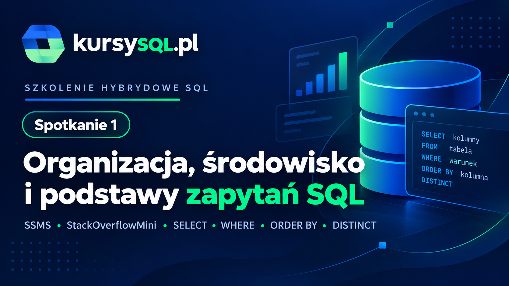

# 01 - Organizacja, środowisko i podstawy zapytań SQL

**20 października 2026 | 19:00-21:00 | Microsoft Teams**

Pierwsze spotkanie poświęcamy przygotowaniu środowiska i podstawom pracy z zapytaniami SQL. Zaczynamy od SQL Server Management Studio i poznania bazy **[StackOverflowMini](https://downloads.brentozar.com/StackOverflow2010.7z)**, a następnie krok po kroku budujemy pierwsze zapytania.

## Szybka nawigacja

| Materiał | Zawartość |
|---|---|
| [01a pierwsze zapytania.sql](./01a%20pierwsze%20zapytania.sql) | Pierwsze `SELECT`, wybór kolumn, aliasy, `TOP` |
| [01b filtrowanie.sql](./01b%20filtrowanie.sql) | `WHERE`, operatory, `AND`, `OR`, `IN`, `BETWEEN`, `LIKE`, `NULL` |
| [01c sortowanie i duplikaty.sql](./01c%20sortowanie%20i%20duplikaty.sql) | `ORDER BY`, sortowanie po wielu kolumnach, `DISTINCT` |
| [01d polaczmy razem.sql](./01d%20polaczmy%20razem.sql) | Przykłady łączące poznane elementy |
| [01z zadanie.sql](./01z%20zadanie.sql) | 10 zadań do samodzielnego rozwiązania |
| [01z zadanie_rozwiazanie.sql](./01z%20zadanie_rozwiazanie.sql) | Rozwiązania zadań |


## Agenda spotkania

### 1. Organizacja szkolenia

Na początku krótko omawiamy:

- jak wygląda cały cykl spotkań,
- gdzie będą dostępne nagrania,
- gdzie znajdziesz skrypty i zadania,
- jak korzystać z repozytorium,
- jak będziemy pracować podczas kolejnych spotkań.

Informacje organizacyjne dotyczące całego cyklu znajdziesz w [głównym README repozytorium](../README.md).

### 2. SQL Server Management Studio

Krótki przegląd środowiska, którego będziemy używać podczas zajęć:

- Object Explorer,
- przeglądanie obiektów bazy danych,
- raporty i sprawdzanie rozmiaru tabel,
- odświeżanie listy obiektów,
- `SELECT TOP 1000 Rows`,
- wykonywanie całego skryptu i zaznaczonego fragmentu,
- wyniki i komunikaty.

Przydatne skróty:

| Skrót | Działanie |
|---|---|
| `F5` | wykonanie zapytania |
| `Alt+F1` | informacje o zaznaczonym obiekcie (`sp_help`) |
| `Ctrl+R` | pokazanie / ukrycie panelu wyników |

### 3. Baza StackOverflowMini

Przykłady wykonujemy na bazie **[StackOverflowMini](https://downloads.brentozar.com/StackOverflow2010.7z)** o rozmiarze około **1,7 GB**.

Na początku poznajemy jej strukturę i kilka najważniejszych tabel, przede wszystkim:

- `dbo.Users` - użytkownicy Stack Overflow,
- `dbo.Posts` - pytania i odpowiedzi,
- pozostałe obiekty dostępne w bazie.

Zakres dat `CreationDate` w tabeli `dbo.Users`:

```text
2008-07-31 00:00:00.000
-
2009-12-31 23:49:05.327
```

### 4. Pierwsze zapytania SQL

Zaczynamy od najprostszych konstrukcji:

```sql
SELECT *
FROM dbo.Users;
```

Następnie przechodzimy do:

- wyboru konkretnych kolumn,
- zmiany kolejności kolumn,
- aliasów,
- `TOP`,
- `TOP ... PERCENT`.

Materiał: [01a pierwsze zapytania.sql](./01a%20pierwsze%20zapytania.sql)

### 5. Filtrowanie danych

Kolejna część to `WHERE` i wybieranie tylko interesujących nas wierszy.

Poruszane zagadnienia:

- operatory `=`, `<>`, `>`, `>=`, `<`, `<=`,
- `AND` i `OR`,
- znaczenie nawiasów w bardziej złożonych warunkach,
- `IN`,
- `BETWEEN`,
- filtrowanie po datach,
- `LIKE`,
- symbole wieloznaczne,
- `NULL`,
- `IS NULL` i `IS NOT NULL`.

Materiał: [01b filtrowanie.sql](./01b%20filtrowanie.sql)

### 6. Sortowanie i unikalne wartości

Następnie dokładamy:

- `ORDER BY`,
- sortowanie rosnące i malejące,
- sortowanie według kilku kolumn,
- połączenie `TOP` z `ORDER BY`,
- `DISTINCT`,
- różnicę pomiędzy powtarzającymi się wartościami a powtarzającymi się całymi wierszami wyniku.

Materiał: [01c sortowanie i duplikaty.sql](./01c%20sortowanie%20i%20duplikaty.sql)

### 7. Łączymy poznane elementy

Na zakończenie części demonstracyjnej budujemy bardziej kompletne zapytania wykorzystujące kilka poznanych elementów jednocześnie.

Przykłady dotyczą m.in.:

- użytkowników z Polski o wysokiej reputacji,
- najczęściej oglądanych postów,
- najwyżej ocenianych postów,
- popularnych pytań związanych z SQL.

Materiał: [01d polaczmy razem.sql](./01d%20polaczmy%20razem.sql)

---

## Zadania

Na koniec - **10 zadań do samodzielnego rozwiązania**.

👉 [01z zadanie.sql](./01z%20zadanie.sql)

Po wykonaniu zadań możesz porównać swoje rozwiązania z przygotowaną wersją:

👉 [01z zadanie_rozwiazanie.sql](./01z%20zadanie_rozwiazanie.sql)

Najpierw spróbuj rozwiązać zadania samodzielnie. W SQL bardzo często istnieje więcej niż jeden poprawny sposób uzyskania oczekiwanego wyniku.

---

## Co dalej?

Na następnym spotkaniu przejdziemy do **grupowania i podsumowywania danych** - funkcji agregujących, `GROUP BY` oraz filtrowania wyników agregacji.

Pełny harmonogram, informacje o nagraniach i zasady udziału w szkoleniu znajdziesz w:

👉 [README głównym repozytorium](../README.md)

👉 [Strona szkolenia hybrydowego na KursySQL.pl](https://www.kursysql.pl/aktualnosci/szkolenie-hybrydowe-pisanie-wydajnych-zapytan/)
