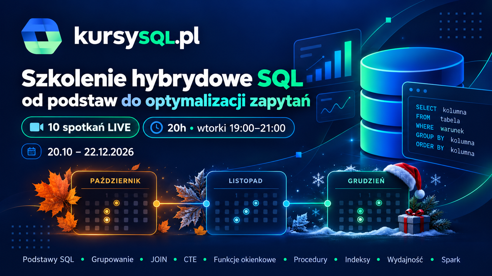

# Pisanie wydajnych zapytań - szkolenie hybrydowe

Szkolenie hybrydowe łączy **nagrania online** z regularnymi, praktycznymi spotkaniami **LIVE na Microsoft Teams**.

Cały cykl prowadzi od podstaw pisania zapytań SQL, przez bardziej zaawansowany T-SQL, aż do indeksów, monitorowania i diagnozowania wydajności. Na zakończenie wyjdziemy również poza klasyczny SQL Server i pokażemy przetwarzanie danych w notatnikach Apache Spark.

> **10 spotkań / 20 godzin LIVE**  
> Wtorki, godz. **19:00-21:00**, od **20 października do 22 grudnia 2026 r.**

## Materiały i nagrania

Nagrania ze spotkań oraz skrypty SQL będą dostępne na **platformie KursySQL.pl**.

Wszyscy uczestnicy szkolenia hybrydowego otrzymają dostęp do materiałów **najpóźniej do 23 października 2026 r.**

Materiały z kolejnych spotkań będą również sukcesywnie pojawiały się w tym repozytorium.

Jeśli chcesz otrzymać dostęp do repozytorium GitHub, napisz na:

**kontakt@kursysql.pl**

## Harmonogram spotkań

| # | Termin | Temat |
|---|---|---|
| 01 | 20.10.2026 | [Organizacja, środowisko i podstawy zapytań SQL](./01%20Zapytania%20SQL/README.md) |
| 02 | 27.10.2026 | Grupowanie i podsumowywanie danych |
| 03 | 03.11.2026 | Łączenie danych z wielu tabel |
| 04 | 10.11.2026 | CTE i funkcje okienkowe |
| 05 | 17.11.2026 | Projektowanie i tworzenie własnej bazy danych |
| 06 | 24.11.2026 | Procedury składowane i transakcje |
| 07 | 01.12.2026 | Indeksy wierszowe |
| 08 | 08.12.2026 | Indeksy kolumnowe |
| 09 | 15.12.2026 | Monitorowanie i diagnozowanie wydajności |
| 10 | 22.12.2026 | Bonus: przetwarzanie danych w notatnikach Apache Spark |

Linki do materiałów z kolejnych modułów będą uzupełniane po ich opublikowaniu.

---

## Jak działa szkolenie hybrydowe?

W ramach cyklu wykorzystujemy trzy szkolenia online:

- **SQL od podstaw**
- **SQL zaawansowany**
- **Optymalizacja zapytań SQL**

Łącznie to około **50 godzin nagranych materiałów**, do których dochodzi **20 godzin spotkań LIVE**.

Jeśli masz dostęp do **dowolnego jednego z tych trzech szkoleń**, możesz uczestniczyć w całym cyklu spotkań LIVE.

### Pakiet 3 szkoleń

Regularna łączna cena trzech szkoleń to **2 583 zł brutto**.

Do **26 października 2026 r.** cały pakiet kosztuje:

## **1 353 zł brutto**

To tyle, ile wcześniej kosztował sam pakiet trzech nagranych szkoleń. W tej edycji dodatkowo otrzymujesz możliwość udziału w całym cyklu **20 godzin spotkań LIVE**.

Możliwa jest również płatność w **2 ratach**.

👉 [Szczegóły szkolenia hybrydowego](https://www.kursysql.pl/aktualnosci/szkolenie-hybrydowe-pisanie-wydajnych-zapytan/)

👉 [Zamów pakiet 3 szkoleń](https://www.kursysql.pl/zamowienie/?add-to-cart=114204)

---

**Tomasz Libera**  
Microsoft MVP Data Platform  
[KursySQL.pl](https://www.kursysql.pl/)
